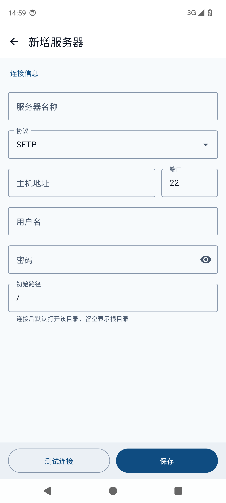
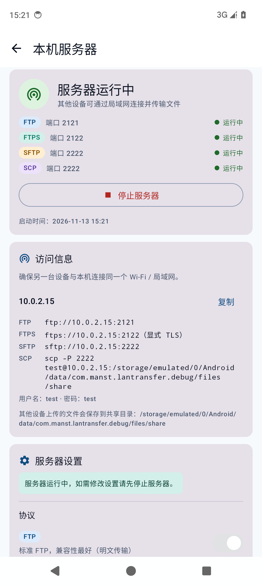
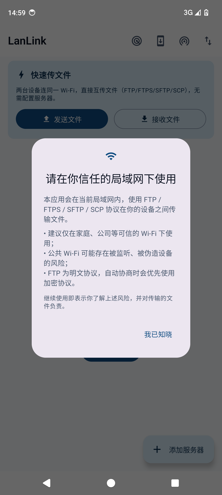

# 局域网传输 LanTransfer

一个 **Android 局域网文件传输** 应用：用手机连接同一局域网内的服务器，通过 **FTP / FTPS / SFTP / SCP** 四种协议浏览远端目录，并上传、下载文件。

> GitHub 仓库：[likebe1-1/lan-transfer-android](https://github.com/likebe1-1/lan-transfer-android)

> 架构选型与设计取舍见 [docs/ARCHITECTURE.md](docs/ARCHITECTURE.md)（ADR-001）。

| 服务器列表 | 远程浏览 | 传输队列 | 新增服务器 |
| --- | --- | --- | --- |
|  |  |  |  |

| 本机服务器运行中 | 共享文件管理 |
| --- | --- |
|  |  |

| 快速传文件（入口） | 发送会话（接收码） | 接收文件 |
| --- | --- | --- |
|  |  |  |

| 首次启动提示 | 传输中速度 / 进度 / 剩余时间 |
| --- | --- |
|  |  |

截图由仪器测试 [ScreenshotTourTest.kt](app/src/androidTest/java/com/manst/lantransfer/e2e/ScreenshotTourTest.kt) 在模拟器上用真实服务端数据生成。

## 功能

- **服务器管理**：新增 / 编辑 / 删除服务器配置，协议彩色标识，最近使用排序，一键「测试连接」。
- **远程浏览**：目录面包屑与上级导航、目录优先排序、文件大小/修改时间、刷新、错误重试。
- **文件操作**：直接下载到公共「下载」根目录（不新建子文件夹，无需存储权限）、通过系统文件选择器多选上传、新建文件夹、重命名、删除（二次确认）。
- **传输队列**：串行执行、实时进度与速度、取消、重试、移除、清空已完成；有任务时以 `dataSync` 前台服务保活并显示进度通知。
- **四协议统一体验**：同一套浏览 / 传输界面，协议差异被适配层屏蔽。
- **本机服务器（收发一体）**：App 内一键启动 FTP / FTPS / SFTP / SCP 服务端，另一台手机或电脑用任意一种协议连接本机，即可下载共享文件、上传文件（手机变成局域网文件站）；支持前台服务保活、访问地址展示、共享文件导入/导出/删除。
- **快速传文件（一键互传）**：两台手机连同一 Wi-Fi，A 选文件后自动开启服务器并显示 6 位接收码；B 在「附近设备」里点一下（或输入 IP + 接收码）即可自动连接、自动下载全部文件；B 也能把文件发回给 A（A 可一键导出到系统下载目录）。全程自动使用 FTP/FTPS/SFTP/SCP 四种协议（接收端自动按加密优先回退，也可手动指定），无需配置服务器/帐号。
- **首次启动安全提示**：第一次打开应用时弹出「请在你信任的局域网下使用」提示，说明本应用会使用局域网协议传输文件、公共 Wi-Fi 的风险与 FTP 明文说明，确认后记录本地偏好、不再重复弹出。
- **传输中实时指标**：传输时实时显示已传/总大小、进度百分比、瞬时速度（如 4.9 MB/s）和预计剩余时间（如「剩余约 8 秒」），客户端传输队列页、快速传文件接收/发送页以及前台服务通知中都会展示；速度按滑动窗口计算，剩余时间由剩余字节/当前速度估算。

## 协议支持

| 协议 | 实现库 | 默认端口 | 认证 | 说明 |
| --- | --- | --- | --- | --- |
| FTP | Apache Commons Net 3.11.1 | 21 | 用户名/密码 | 被动模式默认，可切换主动模式；MLSD 优先、LIST 回退 |
| FTPS | Apache Commons Net 3.11.1 | 21（隐式 990） | 用户名/密码 | 显式 `AUTH TLS`（默认）/ 隐式 TLS；可信任局域网自签名证书 |
| SFTP | JSch 0.2.26（mwiede 维护版） | 22 | 用户名/密码 | 基于 SSH2 子系统，流式传输 + 进度回调 |
| SCP | JSch 0.2.26（mwiede 维护版） | 22 | 用户名/密码 | 手写 SCP 线协议（`scp -f / -t`），元数据操作走远端 POSIX shell |

## 首次启动提示

第一次安装并打开应用时，会展示「请在你信任的局域网下使用」对话框（[截图](docs/screenshots/12_trusted_lan_notice.png)），内容包括：

- 本应用会在当前局域网内使用 FTP/FTPS/SFTP/SCP 传输文件；
- 建议仅在家庭、公司等可信 Wi-Fi 下使用，公共 Wi-Fi 存在被监听/伪造设备风险；
- FTP 为明文协议，自动协商时优先使用加密协议；
- 点击「我已知晓」后记录本地偏好（SharedPreferences），后续启动不再弹出；卸载重装后会再次提示。

## 快速传文件（一键互传）

```
手机 A（发送）                                   手机 B（接收）
┌──────────────────────────┐                    ┌──────────────────────────┐
│ 快速传文件 → 选择文件       │   UDP 局域网广播    │ 快速传文件 → 接收文件       │
│  自动开启 FTP/FTPS/SFTP/  │  47823（设备/码/端口）│  「附近设备」点一下即连接     │
│  SCP 服务端 + 6 位接收码   │ ────────────────>  │  自动下载全部文件到下载目录   │
│  共享会话目录             │ <──────────────── │  「发送文件给对方」反向互传   │
└──────────────────────────┘   FTP/FTPS/SFTP/SCP  └──────────────────────────┘
```

使用步骤：

1. 两台手机连同一个 Wi-Fi；
2. A 打开 App →「快速传文件」→「发送文件」→ 从系统文件选择器选文件（最多 200 个）→ 页面显示 6 位接收码（如 737 229）、本机 IP 与四个协议端口；
3. B 打开 App →「快速传文件」→「接收文件」→ 附近设备列表会出现 A（也可手动输入 A 的 IP + 接收码）→ 点击 A 即自动连接，并按 SFTP → SCP → FTPS → FTP 优先顺序自动选用一种协议，自动下载全部文件到系统「下载」根目录；
4. 互传：B 在连接页点「发送文件给对方」选择文件，即可上传到 A（A 的「收到的文件」会自动出现，可「导出到下载」）；
5. A 点「结束会话」后临时服务器、会话目录与接收码全部清理；B 断开连接。

说明：会话帐号由接收码派生（无需传帐号密码），服务端端口自动选择空闲端口；「附近设备」依赖同一网段的 UDP 广播，若路由器开启了 AP 隔离导致发现不到，可用手动输入 IP + 接收码（此时使用默认端口 2121/2122/2222）。

## 本机服务器（服务端模式）

App 同时是客户端和服务端：

```
手机 A（发送方）                              手机 B / 电脑（接收方）
┌─────────────────────────┐   局域网     ┌──────────────────────────┐
│ 本机服务器（一键启动）    │  FTP/FTPS/  │ 任意标准客户端：           │
│  FTP :2121               │  SFTP/SCP   │  - 本 App 的客户端模式     │
│  FTPS :2122（显式 TLS）  │ ──────────> │  - FileZilla / WinSCP      │
│  SFTP/SCP :2222          │  浏览/下载  │  - 命令行 ftp/sftp/scp     │
│  共享目录（导入文件）     │ <────────── │  上传文件（对方收到）      │
└─────────────────────────┘   上传文件   └──────────────────────────┘
```

使用步骤：

1. App 首页右上角「本机服务器」→ 设置用户名/密码（默认端口 2121/2122/2222，可修改）→「开始服务器」；
2. 页面会显示本机局域网 IPv4 地址与四种协议的连接示例（可一键复制），把它发给另一台设备；
3. 另一台设备用任意 FTP/FTPS/SFTP/SCP 客户端按地址与帐号连接，浏览「共享文件」并下载，或上传文件到本机；
4. 本机在「共享文件」区点「刷新」即可看到对方上传的文件，也可「导入文件」把自己要发的文件放进共享目录、或「导出到下载」；
5. 服务器运行期间由前台服务保活（通知栏显示「本机服务器运行中」），不需要保持界面在前台。

## 架构一览

```
客户端：Compose UI ──StateFlow──> ViewModel ──> ServerRepository / TransferManager
                                                     │
                                                     └──> RemoteFileSystem 抽象
                                                            ├── FtpRemoteFileSystem（FTP/FTPS）
                                                            └── SshRemoteFileSystem（SFTP/SCP）

服务端：Compose UI ──> ServerViewModel ──> LocalServerManager
                                              ├── FtpProtocolServer（自实现 FTP/FTPS，含 TLS）
                                              ├── SshProtocolServer（Apache MINA SSHD：SFTP + SCP）
                                              └── ShareRepository（共享目录）+ LocalServerService（前台保活）
```

- 单 Activity + Compose Navigation，MVVM + 单向数据流，手动依赖注入（`AppContainer`）。
- 协议适配层是**纯 JVM 代码**（不依赖 Android API），可直接用 JVM 单元测试对接内嵌 FTP/SSH 服务器做真实报文测试。
- 每任务独立连接、任务结束即关闭；取消传输 = 关闭连接。

## 构建

前置：JDK 17+（推荐 21）、Android SDK（platform 35、build-tools，设置 `ANDROID_HOME` 或 `local.properties`）、Gradle 由 wrapper 提供。

```powershell
# 统一入口（Windows）：优先使用调用方已设置的 JAVA_HOME；
# 未设置且存在 D:\SDK\JDK21 时使用该路径，否则回退 PATH 中的 java
cmd /c "scripts\gw.cmd" :app:assembleDebug
cmd /c "scripts\gw.cmd" :app:assembleRelease

# 产物
#   app/build/outputs/apk/debug/app-debug.apk
#   app/build/outputs/apk/release/app-release.apk（R8 + 资源压缩）
```

> 克隆本仓库后默认可以直接构建 **debug** 包。**release** 包需要自备签名：新建 `keystore.properties`（含密钥库路径与口令）并使用自己的 `.jks` 文件；签名文件已在 `.gitignore` 中排除，不会进入仓库。

安装：

```powershell
adb install -r app\build\outputs\apk\release\app-release.apk
```

## 测试与验证结果

### 1. JVM 单元测试（无需设备）

```powershell
cmd /c "scripts\gw.cmd" :app:testDebugUnitTest --console=plain
```

**结果：174 个用例全部通过（0 失败）。** 覆盖：

- `core`：远端路径归一化 / 拼接 / 父目录，字节与速度格式化；
- `data`：服务器配置 JSON 持久化（往返、损坏降级、并发写、删除/更新）；
- `transfer`：队列状态机、文件名清洗与重名后缀、速度与进度节流、错误映射；
- `protocol`：用 **MockFtpServer** 与 **Apache MINA SSHD** 在测试内启动真实 FTP/FTPS/SFTP/SCP 服务端，校验列目录、上传下载字节一致性（含 0 字节与 1 MiB 文件）、mkdir/rename/delete、错误密码与未监听端口；
- `server/ftp`（19 个）：自实现 FTP/FTPS 服务端 + 真实客户端走线（LIST/NLST、PASV/EPSV、显式/隐式 TLS、PROT P 数据通道、上传临时文件原子替换、路径穿越 550 等）；
- `server/ssh`（19 个）：MINA SSHD 服务端 SFTP/SCP 回环传输、SCP 元数据 shell 命令（ls -la/mkdir/mv/rm/rmdir）与 POSIX 引号解析、越界拒绝、主机密钥持久化；
- `server` + `data`：共享目录导入/导出/删除、文件名清洗、本机服务器配置持久化；
- `quick`（25 个）：接收码生成/规范化/凭据派生（与收发双端算法逐位一致）、局域网广播报文编解码与非法数据容错、会话文件名清洗/重名/忽略规则、MediaStore 下载目标语义。

### 2. 设备集成测试（真实四协议端到端）

宿主机启动四种协议的测试服务端（Python 3，依赖 `pyftpdlib`、`pyopenssl`、`paramiko`、`cryptography`）：

```powershell
python -m pip install pyftpdlib pyopenssl paramiko cryptography
python scripts\e2e_servers.py --masquerade 10.0.2.2
# 输出：FTP :2121  FTPS :2122  SFTP/SCP :2222  用户 test / test
```

启动模拟器后运行：

```powershell
cmd /c "scripts\gw.cmd" :app:connectedDebugAndroidTest -Pandroid.testInstrumentationRunnerArguments.class=com.manst.lantransfer.e2e.FourProtocolE2ETest --console=plain
```

**结果：在 Android 10（API 29）模拟器上 4 个用例全部通过**（客户端模式）。该测试在 Android 运行时下逐协议真实执行：连接 → 列目录 → 下载 hello.txt → 上传 64KB → 回读字节比对 → 删除，并额外验证错误密码映射 `AuthenticationException`、未监听端口映射 `ConnectionException`、以及传输队列下载落盘 MediaStore。

> 模拟器网络说明：本机 QEMU 模拟器在高速大流量下可能静默丢字节（用设备端 `nc` 复现，非应用问题）。因此 `scripts/e2e_servers.py` 对 FTP/FTPS 数据通道做了限速；脚本内有注释说明，真机不受影响。

### 3. 本机服务器端到端测试（另一台设备连接手机）

两段式验证：

1. **设备内回环**（`ServerModeDeviceTest`、`SshServerDeviceTest`）：在 API 29 模拟器上启动本机服务器，用 App 自身客户端连 127.0.0.1 验证四种协议 list/下载/上传回读/删除；并验证客户端上传的文件出现在共享目录。
2. **宿主作为“另一台设备”**（`ServerModeHostTestBridge` + `scripts/server_mode_hosttest.py`）：模拟器启动服务器后，通过 `adb forward` 把端口映射到宿主机，宿主机用 Python（ftplib / FTP_TLS / paramiko）以普通客户端身份完成：
   - FTP：列目录、下载校验、上传回读；
   - FTPS（显式 TLS）：同上；
   - SFTP：列目录、下载校验、上传 64KB 回读；
   - SCP：`LC_ALL=C ls -la`、`scp -f/-t` 上传下载、`mkdir/mv/rm/rmdir` 元数据操作；
   设备端测试随后断言宿主上传的四个文件全部出现在共享目录。

**结果：宿主机 4/4 协议全部通过；设备端断言通过（OK 16 tests）。**

### 4. UI 冒烟测试

```powershell
cmd /c "scripts\gw.cmd" :app:connectedDebugAndroidTest -Pandroid.testInstrumentationRunnerArguments.class=com.manst.lantransfer.ui.AppSmokeTest --console=plain
```

**结果：通过**（含 `TrustedLanNoticeTest` 首次启动提示与持久化、`AppSmokeTest` 首屏/新增服务器、`ServerScreenSmokeTest` 本机服务器页、`QuickScreenSmokeTest` 快速传文件页、`ShareRepositoryTest` 共享目录、`ScreenshotTourTest` / `ServerScreenshotTest` / `QuickScreenshotTest` 截图巡游）。设备端全部共 **31 个用例通过**（含 `QuickProgressTest` 真实 64MB 传输中速度/剩余时间显示验证）。

### 5. Release（R8 混淆）运行时验证

- `:app:assembleRelease` 产物用 `apksigner` 校验签名通过（CN=LanTransfer）；
- `mapping.txt` 确认 JSch / Commons Net 反射类被完整保留（ProGuard keep 规则生效）；
- 在 API 29 模拟器安装**签名 release APK**，真实添加 SFTP 服务器并浏览远程目录、下载文件到系统下载根目录 `Download/`，下载文件 MD5 与宿主端源文件一致。证明 R8 混淆后 JSch 反射与传输链路正常；
- 同一 release APK 上真实启动本机服务器，宿主机用 FTP/FTPS/SFTP/SCP 四协议完成上传下载回读（4/4 通过），证明 R8 混淆下 MINA SSHD、BouncyCastle 自签证书与自实现 FTP 服务端运行正常。

### 5.1 快速传文件端到端测试

1. **设备内**（`QuickTransferEngineTest`）：真机/模拟器上启动发送会话 → 四种协议分别「连接 + 自动接收 + MediaStore 校验 + 回传互传」→ 会话结束目录清理；另验证 UDP 广播→扫描回环；
2. **跨设备**（`QuickHostE2EBridge` + `scripts/quick_mode_hosttest.py`）：设备启动发送会话后，宿主机作为「另一台设备」读取会话信息，通过三种端口用 FTP/FTPS/SFTP/SCP 下载全部文件（SHA-256 校验）并各上传一个文件；设备端断言对方上传的 4 个文件全部出现在「收到的文件」。

**结果：设备内 4 协议全通过；跨设备 4/4 协议通过，设备端断言通过。**

### 6. 真机验证（Xiaomi 25080RABDC · Android 16 · arm64-v8a）

在真实手机上（无线 ADB 连接）完成了以下验证：

- **设备内功能测试：13 个用例全部通过**（`ServerModeDeviceTest` 本机服务器四协议回环收发 + 共享目录上传落盘；`SshServerDeviceTest` SFTP/SCP 服务端；`ShareRepositoryTest` 共享目录导入/导出/删除）；
- **跨设备端到端：宿主机作为「另一台设备」通过无线 adb forward 连接手机服务器，FTP/FTPS/SFTP/SCP 4/4 协议通过**（列目录、下载校验、上传回读、SCP 元数据命令），设备端测试断言宿主机上传的 4 个文件全部出现在共享目录；
- **签名 release APK（v1.1.0, R8）在真机安装并启动成功**，无崩溃/类缺失；
- 说明：真机当时处于锁屏状态，需要解锁屏幕的 3 个 UI 仪器用例无法自动执行（已在模拟器上全部通过）；手机仍保持 release 版安装，解锁后可直接体验。

### 7. 两台真机互传验证（Xiaomi 24129PN74C + Xiaomi 25080RABDC · Android 16 · 同一 Wi-Fi）

在两台真实手机上（同一 Wi-Fi：HUAWEI-03，IP 分别为 192.168.3.17 / 192.168.3.32）用自动化桥接测试完成真实局域网下的四协议互传：

- **手机 A（发送端）**运行 `TwoPhoneSendBridge`：真实启动「快速传文件」发送会话（接收码 373974、四协议服务端、UDP 广播），把会话信息（IP/端口/派生帐号/文件 SHA-256）写到外部文件供宿主机读取；
- **宿主机编排**：读取会话信息后，驱动**手机 B（接收端）**运行 `TwoPhoneReceiveTest`，B 先通过 UDP 局域网广播发现 A（4 次运行均 `DISCOVERY result=true`），再分别用 **FTP / FTPS / SFTP / SCP** 连接 A，自动接收 2 MB 文件并校验大小（2097152 字节一致），最后各回传一个文件；
- **手机 A 断言**：4 个回传文件（`two-phone-FTP/FTPS/SFTP/SCP-back.bin`）全部出现在「收到的文件」，会话正常结束。

**结果：4/4 协议通过，双向互传全部成功，每次都能通过局域网广播发现对方。**

> 真实环境排查记录：两台手机最初分别连接不同 Wi-Fi（CMCC / HUAWEI-03，恰好都是 192.168.3.x 网段但属于不同二层网络），表现为 TCP 连接 `EHOSTUNREACH`、UDP 广播收不到；切换到同一 SSID 后全部通过。这印证了「快速传文件」依赖同一局域网，也说明接收端「发现失败可手动输入 IP + 接收码」兜底设计的必要性。

#### 两台真机功能测试套件（v1.3.1，2026-11-14）

在两台真机上执行了完整的**非 UI 仪器测试套件**（25 个用例/台，覆盖协议、服务端、共享目录、下载落盘目录、快速传文件引擎与互传）：

| 设备 | 用例 | 结果 |
| --- | --- | --- |
| Xiaomi 24129PN74C（Android 16） | `DownloadRootPathTest`、`QuickTransferEngineTest`、`SessionDataDeviceTest`、`ShareRepositoryTest`、`ServerModeDeviceTest`、`SshServerDeviceTest` | **25/25 通过** |
| Xiaomi 25080RABDC（Android 16） | 同上 | **25/25 通过** |

> UI 仪器测试（Compose 冒烟、截图巡游、首启提示、传输进度截图等）在这两台 MIUI 16 真机上会卡在 `ActivityScenario.launch`（MIUI 限制后台启动 Activity），无法自动执行；这些用例已由 API 29 模拟器完整覆盖（含 35 个 UI/截图/功能用例全绿）。真机功能测试不依赖 UI，因此协议、服务端与下载路径等核心逻辑均已在真机上验证。
>
> 说明：本轮两台手机的跨设备四协议互传已在前面验证通过（4/4）；v1.3.1 相对 v1.3.0 仅调整了下载落盘目录，协议层未变，且新目录已由 `DownloadRootPathTest` 在真机上验证。

## 使用

### 客户端模式（连接其他服务器）

1. 手机与服务器连同一局域网 Wi-Fi；
2. 首页右下角「+」新增服务器：选择协议、填主机/端口/用户名/密码（FTPS 按需选择显式或隐式、信任自签名证书）；
3. 点「测试连接」确认可达后保存；
4. 点击服务器进入远端浏览：点目录进入、点文件下载；右上角上传按钮从系统文件选择器选文件；长按条目可重命名 / 删除；工具栏可新建文件夹；
5. 顶栏队列图标查看进度，支持取消与重试。

### 快速传文件（最简互传）

见上文「快速传文件（一键互传）」：A「发送文件」→ 显示接收码；B「接收文件」→ 附近设备点击即收；B 可反向发送文件给 A。

### 服务端模式（手机之间互传）

见上文「本机服务器（服务端模式）」。两台手机都装本 App 时，A 开启本机服务器并导入文件，B 在客户端模式新增服务器、协议选 FTP/FTPS/SFTP/SCP 任意一种，地址填 A 页面显示的 IP:端口、帐号填 A 设置的用户名密码，即可浏览并下载 A 的文件；B 上传的文件会出现在 A 的共享文件里。

## 目录结构

```
app/src/main/java/com/manst/lantransfer/
├── core/        模型、异常、远端路径与格式化工具
├── protocol/    客户端 RemoteFileSystem 抽象 + FTP/FTPS/SFTP/SCP 适配器
├── server/      本机服务端：LocalServerManager、FTP/FTPS 自实现服务端、MINA SSHD（SFTP/SCP）、前台服务
├── data/        服务器配置仓库、共享目录仓库（JSON 持久化）
├── transfer/    传输队列、MediaStore 下载、通知与前台服务
├── ui/          Compose 界面（列表 / 编辑 / 浏览 / 队列 / 本机服务器）与 ViewModel
├── AppContainer.kt / LanTransferApplication.kt / MainActivity.kt
app/src/test/          JVM 单元测试（含内嵌 FTP/SSH 服务器）
app/src/androidTest/   设备集成测试（四协议端到端 / 截图巡游 / UI 冒烟）
docs/ARCHITECTURE.md   架构决策记录
docs/screenshots/      应用截图
scripts/               构建入口 gw.cmd / gw.ps1、客户端 E2E 服务端 e2e_servers.py、服务端 E2E 宿主客户端 server_mode_hosttest.py
```

## 已知限制

- 不支持断点续传与文件夹递归上传/下载（单文件传输 + 失败重试）；SCP 协议本身不提供 REST 续传；
- SFTP/SCP 未做主机密钥指纹固定校验（首次连接直接信任）；FTPS 默认允许信任自签名证书，可在配置中关闭；
- 服务器密码以明文保存在应用私有目录（`filesDir/servers.json`，其他应用无法读取），未做加密存储；
- 应用进程被系统杀死后，内存中的传输队列不恢复；
- SCP 的列目录/建目录/重命名/删除依赖远端 POSIX shell（仅支持 SCP 传输、无 shell 的服务器只能下载/上传文件）；
- 本机服务器仅密码认证、单个共享目录、FTP 服务端只支持被动模式（PASV/EPSV）；FTPS 使用进程内自签证书，App 重启后证书会重新生成；
- 共享目录位于应用外部私有目录（Android/data/…/files/share），卸载 App 会随之删除；其他设备上传后需在页面「刷新」查看；
- 快速传文件的「附近设备」依赖同网段 UDP 广播，部分路由器开启 AP 隔离时发现不到，可手动输入 IP + 接收码（默认端口）；
- 快速传文件收到的文件保存在会话临时目录，需在会话内「导出到下载」；结束会话后会话目录会被删除（发送方的原始文件不受影响）；
- 快速传文件单次最多 200 个文件、不支持断点续传；会话接收码在局域网广播中明文可见（临时会话设计，仅限可信局域网内置使用）。

## 安全说明

- 所有流量仅在局域网内传输，应用不收集、不上传任何数据；
- FTPS/SFTP/SCP 走标准 TLS/SSH 加密；FTP 为明文协议，仅在可信局域网使用；
- `keystore.properties` 与签名密钥不入库。