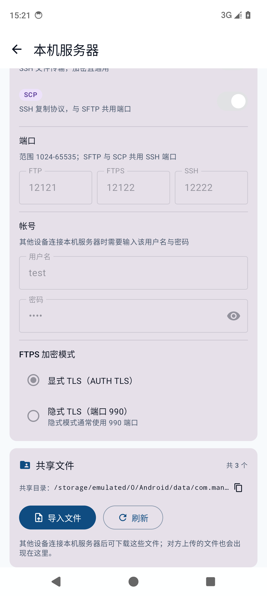
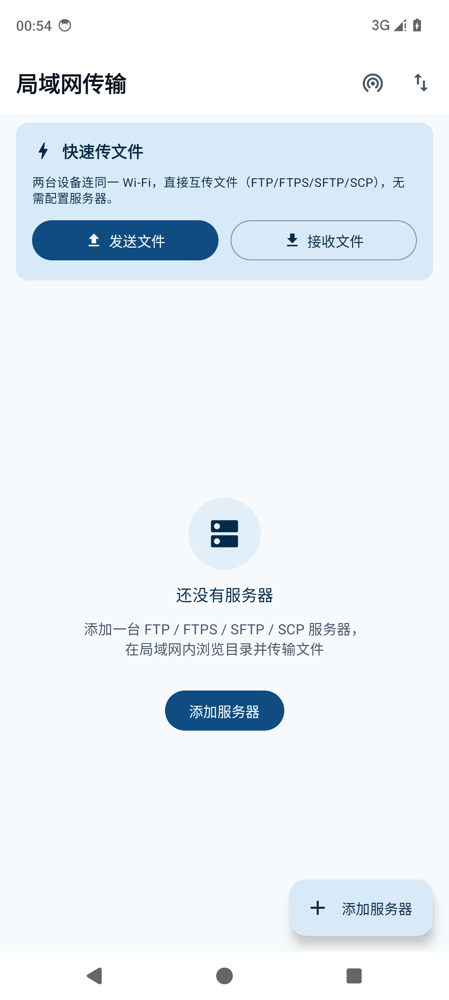
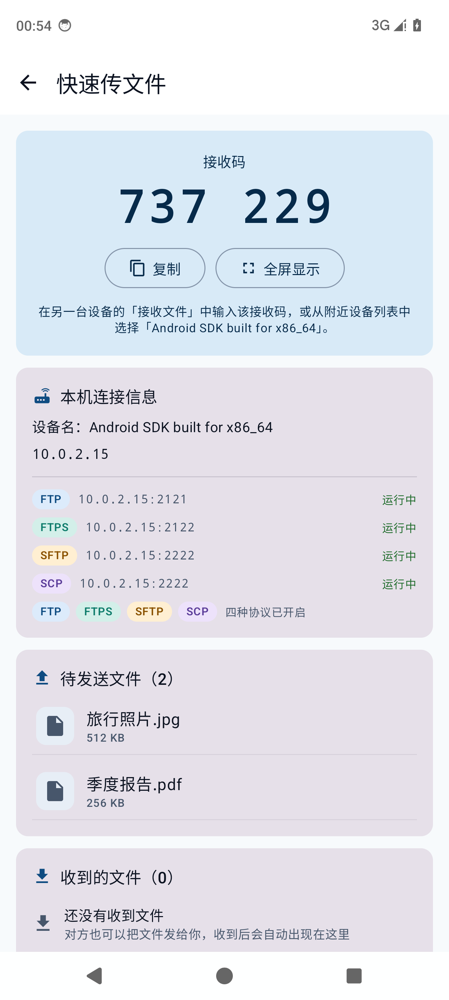
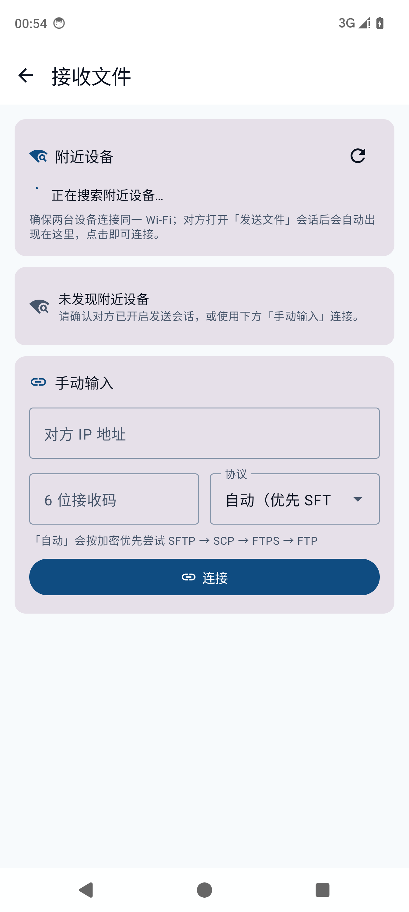
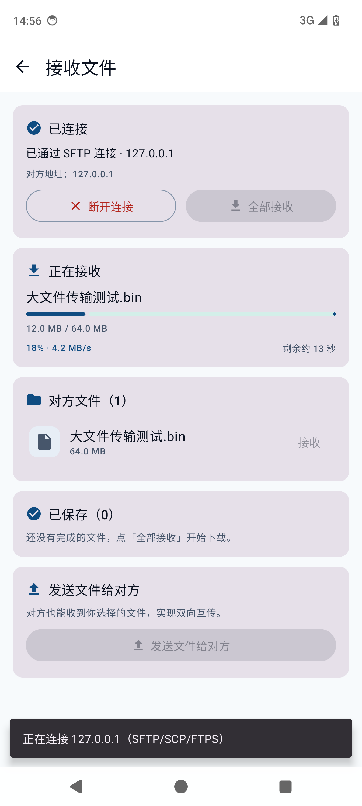
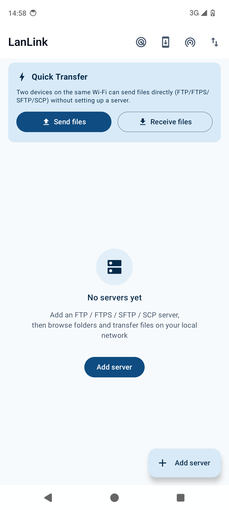
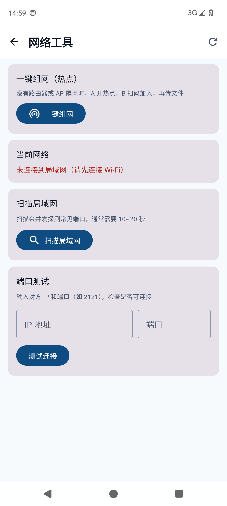
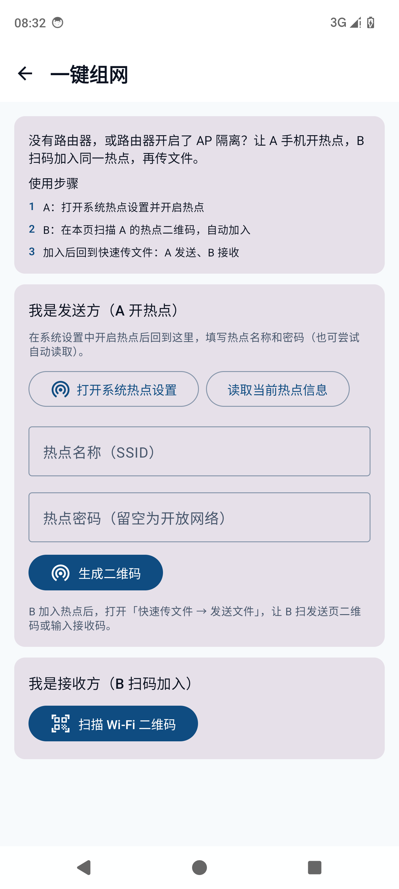

# LanLink（局域网传输）

**官网 / 在线下载页**：https://likebe1-1.github.io/lan-transfer-android/ （由 GitHub Pages + GitHub REST API 提供，实时读取 Releases）

**LanLink** 是一个 **Android 局域网文件传输** 应用：用手机连接同一局域网内的服务器，通过 **FTP / FTPS / SFTP / SCP** 四种协议浏览远端目录，并上传、下载文件。

> GitHub 仓库：[likebe1-1/lan-transfer-android](https://github.com/likebe1-1/lan-transfer-android)

> 架构选型与设计取舍见 [docs/ARCHITECTURE.md](docs/ARCHITECTURE.md)（ADR-001）。

| 服务器列表 | 远程浏览 | 传输队列 | 新增服务器 |
| --- | --- | --- | --- |
|  |  |  |  |

| 本机服务器运行中 | 共享文件管理 |
| --- | --- |
|  |  |

| 快速传文件（入口） | 发送会话（接收码） | 接收文件 |
| --- | --- | --- |
|  |  |  |

| 首次启动提示 | 传输中速度 / 进度 / 剩余时间 |
| --- | --- |
|  |  |

| 英文界面（English UI） | 网络工具 | 一键组网 |
| --- | --- | --- |
|  |  |  |

截图由仪器测试 [ScreenshotTourTest.kt](app/src/androidTest/java/com/manst/lantransfer/e2e/ScreenshotTourTest.kt) 在模拟器上用真实服务端数据生成。

## 下载安装包

历史版本签名 APK 已发布在 [GitHub Releases](https://github.com/likebe1-1/lan-transfer-android/releases)（要求 Android 10+ / minSdk 29）：

| 版本 | 说明 | 直接下载 |
| --- | --- | --- |
| **v2.3.0（最新）** | **性能与安全专项：3 路并发传输 / 证书与主机密钥指纹固定 / 服务端限流 / 凭据 Keystore 加密 / 更新清单 Ed25519 签名** | [arm64-v8a](https://github.com/likebe1-1/lan-transfer-android/releases/download/v2.3.0/LanLink-v2.3.0-arm64-v8a.apk) · [armeabi-v7a](https://github.com/likebe1-1/lan-transfer-android/releases/download/v2.3.0/LanLink-v2.3.0-armeabi-v7a.apk) · [universal](https://github.com/likebe1-1/lan-transfer-android/releases/download/v2.3.0/LanLink-v2.3.0-universal.apk) |
| v2.2.0 | 应用内更新 / 快速传文件安全加固 / 中英文界面 / 网络工具 / 一键组网 | [arm64-v8a](https://github.com/likebe1-1/lan-transfer-android/releases/download/v2.2.0/LanLink-v2.2.0-arm64-v8a.apk) · [armeabi-v7a](https://github.com/likebe1-1/lan-transfer-android/releases/download/v2.2.0/LanLink-v2.2.0-armeabi-v7a.apk) · [universal](https://github.com/likebe1-1/lan-transfer-android/releases/download/v2.2.0/LanLink-v2.2.0-universal.apk) |
| v2.1.1 | ABI 拆分 + 资源精简：arm64 包 10.44 MiB | [arm64-v8a](https://github.com/likebe1-1/lan-transfer-android/releases/download/v2.1.1/LanLink-v2.1.1-arm64-v8a.apk) · [armeabi-v7a](https://github.com/likebe1-1/lan-transfer-android/releases/download/v2.1.1/LanLink-v2.1.1-armeabi-v7a.apk) · [universal](https://github.com/likebe1-1/lan-transfer-android/releases/download/v2.1.1/LanLink-v2.1.1-universal.apk) |
| v2.1.0 | LanLink 品牌版 + 断点续传 / 文件夹 / 历史 / 分享 / 扫码快传 | [LanLink-v2.1.0.apk](https://github.com/likebe1-1/lan-transfer-android/releases/download/v2.1.0/LanLink-v2.1.0.apk) |
| v2.0.0 | 断点续传 / 文件夹传输 / 历史记录 / 分享直达 / 扫码快传 | [LanTransfer-v2.0.0.apk](https://github.com/likebe1-1/lan-transfer-android/releases/download/v2.0.0/LanTransfer-v2.0.0.apk) |
| v1.3.1 | 下载直接写入系统下载根目录 | [LanTransfer-v1.3.1.apk](https://github.com/likebe1-1/lan-transfer-android/releases/download/v1.3.1/LanTransfer-v1.3.1.apk) |
| v1.3.0 | 传输中显示进度 / 速度 / 剩余时间 | [LanTransfer-v1.3.0.apk](https://github.com/likebe1-1/lan-transfer-android/releases/download/v1.3.0/LanTransfer-v1.3.0.apk) |
| v1.2.1 | 首次启动安全提示 | [LanTransfer-v1.2.1.apk](https://github.com/likebe1-1/lan-transfer-android/releases/download/v1.2.1/LanTransfer-v1.2.1.apk) |
| v1.2.0 | 快速传文件（一键互传） | [LanTransfer-v1.2.0.apk](https://github.com/likebe1-1/lan-transfer-android/releases/download/v1.2.0/LanTransfer-v1.2.0.apk) |
| v1.1.0 | 本机服务器（手机互传） | [LanTransfer-v1.1.0.apk](https://github.com/likebe1-1/lan-transfer-android/releases/download/v1.1.0/LanTransfer-v1.1.0.apk) |
| v1.0.0 | 局域网文件传输（客户端） | [LanTransfer-v1.0.0.apk](https://github.com/likebe1-1/lan-transfer-android/releases/download/v1.0.0/LanTransfer-v1.0.0.apk) |

> APK 与 `v1.0.0` ~ `v2.3.0` 标签一一对应，均由同一签名密钥（CN=LanTransfer）签名；安装新版本可直接覆盖旧版本。

**v2.3.0 分 ABI 下载**（GitHub Releases）：

| 架构 | 直接下载 |
| --- | --- |
| arm64-v8a（推荐） | [LanLink-v2.2.0-arm64-v8a.apk](https://github.com/likebe1-1/lan-transfer-android/releases/download/v2.2.0/LanLink-v2.2.0-arm64-v8a.apk) |
| armeabi-v7a | [LanLink-v2.2.0-armeabi-v7a.apk](https://github.com/likebe1-1/lan-transfer-android/releases/download/v2.2.0/LanLink-v2.2.0-armeabi-v7a.apk) |
| universal | [LanLink-v2.2.0-universal.apk](https://github.com/likebe1-1/lan-transfer-android/releases/download/v2.2.0/LanLink-v2.2.0-universal.apk) |

发布说明：[docs/RELEASE_NOTES_v2.2.0.md](docs/RELEASE_NOTES_v2.2.0.md) · 蓝奏云备用：https://wwbds.lanzoum.com/b0139vopuf （密码 1234）

## 功能

- **服务器管理**：新增 / 编辑 / 删除服务器配置，协议彩色标识，最近使用排序，一键「测试连接」。
- **远程浏览**：目录面包屑与上级导航、目录优先排序、文件大小/修改时间、刷新、错误重试。
- **文件操作**：直接下载到公共「下载」根目录（不新建子文件夹，无需存储权限）、通过系统文件选择器多选上传、新建文件夹、重命名、删除（二次确认）。
- **传输队列**：串行执行、实时进度与速度、取消、重试、移除、清空已完成；有任务时以 `dataSync` 前台服务保活并显示进度通知。
- **四协议统一体验**：同一套浏览 / 传输界面，协议差异被适配层屏蔽。
- **本机服务器（收发一体）**：App 内一键启动 FTP / FTPS / SFTP / SCP 服务端，另一台手机或电脑用任意一种协议连接本机，即可下载共享文件、上传文件（手机变成局域网文件站）；支持前台服务保活、访问地址展示、共享文件导入/导出/删除。
- **快速传文件（一键互传）**：两台手机连同一 Wi-Fi，A 选文件后自动开启服务器并显示 8 位接收码；B 在「附近设备」里点设备并输入 A 屏幕上的 8 位接收码（或手动输入 IP + 接收码，或扫描发送页二维码）即可连接、自动下载全部文件；B 也能把文件发回给 A（A 可一键导出到系统下载目录）。全程自动使用 FTP/FTPS/SFTP/SCP 四种协议（接收端自动按加密优先回退，也可手动指定），无需配置服务器/帐号。
- **首次启动安全提示**：第一次打开应用时弹出「请在你信任的局域网下使用」提示，说明本应用会使用局域网协议传输文件、公共 Wi-Fi 的风险与 FTP 明文说明，确认后记录本地偏好、不再重复弹出。
- **传输中实时指标**：传输时实时显示已传/总大小、进度百分比、瞬时速度（如 4.9 MB/s）和预计剩余时间（如「剩余约 8 秒」），客户端传输队列页、快速传文件接收/发送页以及前台服务通知中都会展示；速度按滑动窗口计算，剩余时间由剩余字节/当前速度估算。
- **断点续传与自动重试**：下载先写本地暂存文件，中断后从已下载字节继续（FTP/FTPS/SFTP 支持，SCP 自动从 0 重传）；上传按远端已有大小续传；网络类失败自动重试 3 次（2s/4s/8s 退避），App 重启后未完成任务自动恢复并继续。
- **文件夹递归传输**：浏览器页可「下载当前文件夹」（远端目录递归下载，保留子目录结构）与「上传文件夹」（SAF 目录树递归上传，自动创建远端目录）。
- **传输历史与队列持久化**：任务状态持久化到本地，App 重启后历史仍在、未完成任务自动继续；支持清空历史、点击历史中的下载文件直接打开。
- **系统分享直达快速传**：在相册/文件管理器选择文件后「分享」到本应用，直接进入快速传文件发送页并用这些文件开启会话。
- **扫码快速传输**：发送页显示接收码二维码，接收页「扫码加入」用相机扫描自动连接；二维码外层载荷为 **Base64(UTF-8 JSON)**（JSON 含接收码、设备名、IP、端口、协议），不携带明文密码。
- **快速传文件安全加固**：UDP 广播只携带设备名/IP/端口/协议，**不含接收码**；接收方需点击设备后输入接收码（**8 位**，兼容旧版 6 位）；**服务端**三层限流：同一来源 10 分钟内 5 次失败即锁定（逐级 1/5/10 分钟）、全局失败速率上限（默认 60 次/分钟触发 30 秒冷却）、以及可信来源阶梯（NAT 后正常设备不会被一次误输锁 10 分钟）；FTP/FTPS/SFTP/SCP 全部生效。
- **应用内更新**：启动时静默检查 `docs/update.json`（Gitee / jsDelivr / GitHub raw / ghproxy 多源，**仅 HTTPS**，且要求 **Ed25519 签名**），有新版本弹窗展示更新日志；下载走 GitHub Releases 多镜像、校验 SHA-256 与 APK 签名后拉起系统安装；GitHub 不可用时提供**蓝奏云浏览器下载**兜底（链接与密码随清单下发）。
- **中英文界面**：所有界面文案已抽取到 `strings.xml` 并配齐 `values-en/`（294 条），系统语言为英文时自动显示英文界面（中文环境保持中文）；动态提示（Snackbar/错误文案）暂时仍为中文。
- **快速传文件接收断点续传**：接收端先写 App 私有分片，FTP/FTPS/SFTP 从断点续传，成功后复制到系统下载目录；失败/取消保留分片，重试自动续传，7 天孤儿分片自动清理（SCP 不支持偏移，仍整文件重传）。
- **收到文件自动保留**：快速传文件会话结束时，对方发回的文件自动导出到系统「下载」目录（保留子目录结构），不再随会话目录删除；手动导出过的文件不会重复导出。
- **共享目录自动刷新**：本机服务器页可见时每约 5 秒静默刷新，回到前台立即刷新，无需手动点「刷新」。
- **通知栏操作**：传输进度通知新增「取消」按钮，一键取消全部活动传输；下载完成通知保留「打开」按钮。
- **桌面快捷方式**：长按桌面图标可直接「发送文件 / 接收文件 / 启动服务器」，冷启动与 App 运行中都生效。
- **网络工具（局域网雷达/诊断）**：首页顶栏进入；展示本机 IP/子网/网关，扫描同网段设备（IP、MAC、主机名、开放端口、设备类型），自动识别正在等待接收的 LanLink 设备；给出同网段/网关可达/设备发现/AP 隔离诊断，并支持任意 IP:端口 连通性测试。
- **一键组网（热点二维码）**：没有路由器或 AP 隔离时，A 手机开热点并用 LanLink 生成「热点二维码」，B 手机在 LanLink 里扫码自动加入该热点，然后回到快速传文件互传；B 的加入是应用级 Wi-Fi 连接（不修改系统 Wi-Fi 设置），加入后 App 进程绑定热点网络。
- **下载完成通知打开文件**：下载完成通知带「打开」动作，点击直接打开已保存的文件（无 Uri 时回退打开 App）。

## v2.0 实用功能（P0）

| 功能 | 使用方式 |
| --- | --- |
| 断点续传 + 自动重试 | 大文件中断后自动从已传字节继续；网络类失败 3 次退避重试，App 重启自动恢复未完成任务 |
| 文件夹递归传输 | 浏览器页「下载当前文件夹」/「上传文件夹」，保留目录结构（单次最多 1000 个文件） |
| 传输历史 + 队列持久化 | 传输队列页「历史记录」区；重启 App 后历史与新任务自动恢复 |
| 系统分享直达 | 任意 App 中选择文件 → 分享 → 局域网传输 → 自动进入发送会话 |
| 扫码快速传输 | 发送页二维码；接收页「扫码加入」；二维码内容 = Base64(JSON) |
| 通知打开文件 | 下载完成通知的「打开」动作直接打开文件 |
| 通知取消传输 | 进度通知的「取消」按钮一键取消全部活动传输 |
| 桌面快捷方式 | 长按图标进入发送/接收/本机服务器 |
| 快速传文件续传 | 接收中断后从分片断点继续（FTP/FTPS/SFTP） |
| 收到文件自动保留 | 会话结束自动把对方发回的文件保存到「下载」 |
| 网络工具 | 首页 → 网络工具：局域网设备雷达 + 网络诊断 + 端口测试 |
| 一键组网 | 网络工具 → 一键组网：A 开热点生成二维码，B 扫码加入后传文件 |

> 扫码二维码编码规则（v2.0）：会话信息先序列化为 UTF-8 JSON（字段 v/code/name/addrs/ftp/ftps/ssh/protocols），再整体做 Base64（URL-safe）编码后生成二维码；接收端扫码得到 Base64 → 解码 JSON → 用接收码派生临时凭据连接，不携带明文密码。

## 应用内更新

App 启动时会从以下来源依次拉取更新清单（任一可用即可）：

1. `https://cdn.jsdelivr.net/gh/likebe1-1/lan-transfer-android@master/docs/update.json`
2. `https://raw.githubusercontent.com/likebe1-1/lan-transfer-android/master/docs/update.json`
3. `https://ghproxy.net/…` / `https://ghfast.top/…` 镜像

点击首页顶栏的「检查更新」会先弹出「正在检查更新…」对话框（可关闭），完成后提示新版本 / 已是最新 / 失败重试；发现新版本后：下载 GitHub Release APK（自动尝试直连与镜像前缀）→ 校验大小/SHA-256/APK 签名（必须与已安装版本一致）→ 拉起系统安装器。下载中可查看进度；下载失败或 GitHub 无法访问时，可点「蓝奏云下载」在浏览器打开备用地址（当前为文件夹分享，密码 **1234**，密码会自动复制到剪贴板）。

> 发布新版本时需同步更新 `docs/update.json`：`versionCode`/`versionName`/`changelog`/各 ABI 的 `size`+`sha256`+`urls`（GitHub Release 直链），以及蓝奏云链接/密码。蓝奏云可先用 PC 端上传 APK（非会员手机端分享 APK 受限）。

## 体积优化（v2.1.1）

v2.1.1 按 ABI 拆分 APK 并精简资源，安装包明显减小（包名不变，可直接覆盖升级）：

| 产物 | 大小 | 说明 |
| --- | --- | --- |
| v2.1.0 universal（优化前） | 12,342,911 B（11.77 MiB） | 单一 APK 含全部 ABI 与多语言资源 |
| **v2.1.1 arm64-v8a** | **10,949,693 B（10.44 MiB）** | **现代手机首选，下载量减少约 11.3%** |
| v2.1.1 armeabi-v7a | 10,946,851 B（10.44 MiB） | 32 位 ARM 老设备 |
| v2.1.1 x86_64 | 10,950,354 B（10.44 MiB） | 模拟器/极少见 x86 设备 |
| v2.1.1 universal | 10,999,766 B（10.49 MiB） | 不确定 ABI 时使用，兼容所有设备 |

优化手段：

- Gradle `splits.abi` 按 `armeabi-v7a / arm64-v8a / x86 / x86_64` 生成独立签名 APK，并提供 universal 兜底；
- `resourceConfigurations = ["zh", "en"]` 精简依赖库内置的多语言资源；
- 移除未使用的 BouncyCastle PQC 参数资源与多语言错误文案（约 1.3 MB 压缩后体积）；
- 说明：本 App 原生库很小（仅 `libandroidx.graphics.path.so` 约 40 KB），ABI 拆分本身仅省约 50 KB，主要收益来自资源精简；dex（SSHD/BouncyCastle/JSch/Compose）仍是主要体积来源，后续可通过发布 AAB（`bundle {}` 已配置语言/密度/ABI 拆分）或替换静态证书去掉 BouncyCastle 进一步减小。

## 协议支持

| 协议 | 实现库 | 默认端口 | 认证 | 说明 |
| --- | --- | --- | --- | --- |
| FTP | Apache Commons Net 3.11.1 | 21 | 用户名/密码 | 被动模式默认，可切换主动模式；MLSD 优先、LIST 回退 |
| FTPS | Apache Commons Net 3.11.1 | 21（隐式 990） | 用户名/密码 | 显式 `AUTH TLS`（默认）/ 隐式 TLS；可信任局域网自签名证书 |
| SFTP | JSch 0.2.26（mwiede 维护版） | 22 | 用户名/密码 | 基于 SSH2 子系统，流式传输 + 进度回调 |
| SCP | JSch 0.2.26（mwiede 维护版） | 22 | 用户名/密码 | 手写 SCP 线协议（`scp -f / -t`），元数据操作走远端 POSIX shell |

## 首次启动提示

第一次安装并打开应用时，会展示「请在你信任的局域网下使用」对话框（[截图](docs/screenshots/12_trusted_lan_notice.png)），内容包括：

- 本应用会在当前局域网内使用 FTP/FTPS/SFTP/SCP 传输文件；
- 建议仅在家庭、公司等可信 Wi-Fi 下使用，公共 Wi-Fi 存在被监听/伪造设备风险；
- FTP 为明文协议，自动协商时优先使用加密协议；
- 点击「我已知晓」后记录本地偏好（SharedPreferences），后续启动不再弹出；卸载重装后会再次提示。

## 快速传文件（一键互传）

```
手机 A（发送）                                   手机 B（接收）
┌──────────────────────────┐                    ┌──────────────────────────┐
│ 快速传文件 → 选择文件       │   UDP 局域网广播    │ 快速传文件 → 接收文件       │
│  自动开启 FTP/FTPS/SFTP/  │  47823（设备/码/端口）│  「附近设备」点一下即连接     │
│  SCP 服务端 + 8 位接收码   │ ────────────────>  │  自动下载全部文件到下载目录   │
│  共享会话目录             │ <──────────────── │  「发送文件给对方」反向互传   │
└──────────────────────────┘   FTP/FTPS/SFTP/SCP  └──────────────────────────┘
```

使用步骤：

1. 两台手机连同一个 Wi-Fi；
2. A 打开 App →「快速传文件」→「发送文件」→ 从系统文件选择器选文件（最多 200 个）→ 页面显示 8 位接收码（如 1234 5678，旧版为 6 位）、本机 IP 与四个协议端口；
3. B 打开 App →「快速传文件」→「接收文件」→ 附近设备列表会出现 A（只显示设备名/IP/端口，不含接收码）→ 点击 A 并输入 A 屏幕上的 8 位接收码（也可手动输入 IP+接收码、或扫码加入）→ 连接成功后按 SFTP → SCP → FTPS 优先（明文 FTP 不再自动尝试）顺序自动选用一种协议，自动下载全部文件到系统「下载」根目录；
4. 互传：B 在连接页点「发送文件给对方」选择文件，即可上传到 A（A 的「收到的文件」会自动出现，可「导出到下载」）；
5. A 点「结束会话」后临时服务器、会话目录与接收码全部清理；B 断开连接。

说明：会话帐号由接收码派生（无需传帐号密码），服务端端口自动选择空闲端口；「附近设备」依赖同一网段的 UDP 广播，若路由器开启了 AP 隔离导致发现不到，可用手动输入 IP + 接收码（此时使用默认端口 2121/2122/2222）。

## 本机服务器（服务端模式）

App 同时是客户端和服务端：

```
手机 A（发送方）                              手机 B / 电脑（接收方）
┌─────────────────────────┐   局域网     ┌──────────────────────────┐
│ 本机服务器（一键启动）    │  FTP/FTPS/  │ 任意标准客户端：           │
│  FTP :2121               │  SFTP/SCP   │  - 本 App 的客户端模式     │
│  FTPS :2122（显式 TLS）  │ ──────────> │  - FileZilla / WinSCP      │
│  SFTP/SCP :2222          │  浏览/下载  │  - 命令行 ftp/sftp/scp     │
│  共享目录（导入文件）     │ <────────── │  上传文件（对方收到）      │
└─────────────────────────┘   上传文件   └──────────────────────────┘
```

使用步骤：

1. App 首页右上角「本机服务器」→ 设置用户名/密码（默认端口 2121/2122/2222，可修改）→「开始服务器」；
2. 页面会显示本机局域网 IPv4 地址与四种协议的连接示例（可一键复制），把它发给另一台设备；
3. 另一台设备用任意 FTP/FTPS/SFTP/SCP 客户端按地址与帐号连接，浏览「共享文件」并下载，或上传文件到本机；
4. 本机在「共享文件」区点「刷新」即可看到对方上传的文件，也可「导入文件」把自己要发的文件放进共享目录、或「导出到下载」；
5. 服务器运行期间由前台服务保活（通知栏显示「本机服务器运行中」），不需要保持界面在前台。

## 架构一览

```
客户端：Compose UI ──StateFlow──> ViewModel ──> ServerRepository / TransferManager
                                                     │
                                                     └──> RemoteFileSystem 抽象
                                                            ├── FtpRemoteFileSystem（FTP/FTPS）
                                                            └── SshRemoteFileSystem（SFTP/SCP）

服务端：Compose UI ──> ServerViewModel ──> LocalServerManager
                                              ├── FtpProtocolServer（自实现 FTP/FTPS，含 TLS）
                                              ├── SshProtocolServer（Apache MINA SSHD：SFTP + SCP）
                                              └── ShareRepository（共享目录）+ LocalServerService（前台保活）
```

- 单 Activity + Compose Navigation，MVVM + 单向数据流，手动依赖注入（`AppContainer`）。
- 协议适配层是**纯 JVM 代码**（不依赖 Android API），可直接用 JVM 单元测试对接内嵌 FTP/SSH 服务器做真实报文测试。
- 每任务独立连接、任务结束即关闭；取消传输 = 关闭连接。

## 工程化与发布文档

| 文档 | 内容 |
| --- | --- |
| [docs/CI.md](docs/CI.md) | GitHub Actions CI（单测 + lint + debug 构建）、本地复现、badge |
| [docs/RELEASING.md](docs/RELEASING.md) | 一键发版 SOP（bump → 构建 → 清单签名 → Gitee → 自检） |
| [docs/DEPENDENCIES.md](docs/DEPENDENCIES.md) | 关键依赖版本、风险与升级检查清单 |
| [docs/SECRETS.md](docs/SECRETS.md) | 凭据/密钥清单、备份恢复、轮换与泄露应急 |

常用命令：

```bash
python scripts/release.py --dry-run                 # 预演发版流程（默认 dry-run，不改文件）
powershell -File scripts/backup_signing_key.ps1 -Destination D:\lanlink-backup   # 备份签名材料
```

## 构建

前置：JDK 17+（推荐 21）、Android SDK（platform 35、build-tools，设置 `ANDROID_HOME` 或 `local.properties`）、Gradle 由 wrapper 提供。

```powershell
# 统一入口（Windows）：优先使用调用方已设置的 JAVA_HOME；
# 未设置且存在 D:\SDK\JDK21 时使用该路径，否则回退 PATH 中的 java
cmd /c "scripts\gw.cmd" :app:assembleDebug
cmd /c "scripts\gw.cmd" :app:assembleRelease

# 产物
#   app/build/outputs/apk/debug/app-debug.apk
#   app/build/outputs/apk/release/app-release.apk（R8 + 资源压缩）
```

> 克隆本仓库后默认可以直接构建 **debug** 包。**release** 包需要自备签名：新建 `keystore.properties`（含密钥库路径与口令）并使用自己的 `.jks` 文件；签名文件已在 `.gitignore` 中排除，不会进入仓库。

安装：

```powershell
adb install -r app\build\outputs\apk\release\app-release.apk
```

## 测试与验证结果

### 1. JVM 单元测试（无需设备）

```powershell
cmd /c "scripts\gw.cmd" :app:testDebugUnitTest --console=plain
```

**结果：265 个用例全部通过（0 失败）。** 覆盖：

- `core`：远端路径归一化 / 拼接 / 父目录，字节与速度格式化；
- `data`：服务器配置 JSON 持久化（往返、损坏降级、并发写、删除/更新）；
- `transfer`：队列状态机、文件名清洗与重名后缀、速度与进度节流、错误映射；
- `protocol`：用 **MockFtpServer** 与 **Apache MINA SSHD** 在测试内启动真实 FTP/FTPS/SFTP/SCP 服务端，校验列目录、上传下载字节一致性（含 0 字节与 1 MiB 文件）、mkdir/rename/delete、错误密码与未监听端口；
- `server/ftp`（19 个）：自实现 FTP/FTPS 服务端 + 真实客户端走线（LIST/NLST、PASV/EPSV、显式/隐式 TLS、PROT P 数据通道、上传临时文件原子替换、路径穿越 550 等）；
- `server/ssh`（19 个）：MINA SSHD 服务端 SFTP/SCP 回环传输、SCP 元数据 shell 命令（ls -la/mkdir/mv/rm/rmdir）与 POSIX 引号解析、越界拒绝、主机密钥持久化；
- `server` + `data`：共享目录导入/导出/删除、文件名清洗、本机服务器配置持久化；
- `quick`（60 个）：接收码生成/规范化/凭据派生、局域网广播 v2（不含接收码）编解码与非法数据容错、接收码错误次数限流（5 次/10 分钟）、二维码 Base64 载荷编解码、会话文件名清洗/重名/忽略规则、文件夹相对路径映射、MediaStore 下载目标语义、接收断点续传分片决策与孤儿清理。
- `transfer`（48 个）：队列状态机、文件名清洗、进度节流、错误映射、传输任务 JSON 持久化（往返/损坏回退/历史上限）、自动重试策略与退避、文件夹路径清洗/穿越防护。
- `protocol`（58 个）：真实 FTP/FTPS/SFTP/SCP 服务端上的下载/上传中断续传（REST/APPE、SFTP offset）、远端大小校验、SCP 不支持续传的回退行为。

### 2. 设备集成测试（真实四协议端到端）

宿主机启动四种协议的测试服务端（Python 3，依赖 `pyftpdlib`、`pyopenssl`、`paramiko`、`cryptography`）：

```powershell
python -m pip install pyftpdlib pyopenssl paramiko cryptography
python scripts\e2e_servers.py --masquerade 10.0.2.2
# 输出：FTP :2121  FTPS :2122  SFTP/SCP :2222  用户 test / test
```

启动模拟器后运行：

```powershell
cmd /c "scripts\gw.cmd" :app:connectedDebugAndroidTest -Pandroid.testInstrumentationRunnerArguments.class=com.manst.lantransfer.e2e.FourProtocolE2ETest --console=plain
```

**结果：在 Android 10（API 29）模拟器上 4 个用例全部通过**（客户端模式）。该测试在 Android 运行时下逐协议真实执行：连接 → 列目录 → 下载 hello.txt → 上传 64KB → 回读字节比对 → 删除，并额外验证错误密码映射 `AuthenticationException`、未监听端口映射 `ConnectionException`、以及传输队列下载落盘 MediaStore。

> 模拟器网络说明：本机 QEMU 模拟器在高速大流量下可能静默丢字节（用设备端 `nc` 复现，非应用问题）。因此 `scripts/e2e_servers.py` 对 FTP/FTPS 数据通道做了限速；脚本内有注释说明，真机不受影响。

### 3. 本机服务器端到端测试（另一台设备连接手机）

两段式验证：

1. **设备内回环**（`ServerModeDeviceTest`、`SshServerDeviceTest`）：在 API 29 模拟器上启动本机服务器，用 App 自身客户端连 127.0.0.1 验证四种协议 list/下载/上传回读/删除；并验证客户端上传的文件出现在共享目录。
2. **宿主作为“另一台设备”**（`ServerModeHostTestBridge` + `scripts/server_mode_hosttest.py`）：模拟器启动服务器后，通过 `adb forward` 把端口映射到宿主机，宿主机用 Python（ftplib / FTP_TLS / paramiko）以普通客户端身份完成：
   - FTP：列目录、下载校验、上传回读；
   - FTPS（显式 TLS）：同上；
   - SFTP：列目录、下载校验、上传 64KB 回读；
   - SCP：`LC_ALL=C ls -la`、`scp -f/-t` 上传下载、`mkdir/mv/rm/rmdir` 元数据操作；
   设备端测试随后断言宿主上传的四个文件全部出现在共享目录。

**结果：宿主机 4/4 协议全部通过；设备端断言通过（OK 16 tests）。**

### 4. UI 冒烟测试

```powershell
cmd /c "scripts\gw.cmd" :app:connectedDebugAndroidTest -Pandroid.testInstrumentationRunnerArguments.class=com.manst.lantransfer.ui.AppSmokeTest --console=plain
```

**结果：通过**（含 `TrustedLanNoticeTest` 首次启动提示与持久化、`AppSmokeTest` 首屏/新增服务器、`ServerScreenSmokeTest` 本机服务器页、`QuickScreenSmokeTest` 快速传文件页、`ShareRepositoryTest` 共享目录、`ScreenshotTourTest` / `ServerScreenshotTest` / `QuickScreenshotTest` 截图巡游）。设备端全部共 **65 个用例通过**（新增一键组网、网络工具、快速传文件续传/自动保留、通知取消按钮、桌面快捷方式、共享目录自动刷新等用例）（含 `QuickProgressTest` 真实 64MB 传输中速度/剩余时间、`TransferPersistenceDeviceTest` 队列恢复/自动重试、`FolderTransferDeviceTest` 子目录落盘与通知打开、`QuickFolderTransferDeviceTest` 快捷传文件递归接收、`QuickScreenSmokeTest` 二维码按钮、`BrowserAndTransfersSmokeTest` 文件夹入口/历史清空）。

### 5. Release（R8 混淆）运行时验证

- `:app:assembleRelease` 产物用 `apksigner` 校验签名通过（CN=LanTransfer）；
- `mapping.txt` 确认 JSch / Commons Net 反射类被完整保留（ProGuard keep 规则生效）；
- 在 API 29 模拟器安装**签名 release APK**，真实添加 SFTP 服务器并浏览远程目录、下载文件到系统下载根目录 `Download/`，下载文件 MD5 与宿主端源文件一致。证明 R8 混淆后 JSch 反射与传输链路正常；
- 同一 release APK 上真实启动本机服务器，宿主机用 FTP/FTPS/SFTP/SCP 四协议完成上传下载回读（4/4 通过），证明 R8 混淆下 MINA SSHD、BouncyCastle 自签证书与自实现 FTP 服务端运行正常。

### 5.1 快速传文件端到端测试

1. **设备内**（`QuickTransferEngineTest`）：真机/模拟器上启动发送会话 → 四种协议分别「连接 + 自动接收 + MediaStore 校验 + 回传互传」→ 会话结束目录清理；另验证 UDP 广播→扫描回环；
2. **跨设备**（`QuickHostE2EBridge` + `scripts/quick_mode_hosttest.py`）：设备启动发送会话后，宿主机作为「另一台设备」读取会话信息，通过三种端口用 FTP/FTPS/SFTP/SCP 下载全部文件（SHA-256 校验）并各上传一个文件；设备端断言对方上传的 4 个文件全部出现在「收到的文件」。

**结果：设备内 4 协议全通过；跨设备 4/4 协议通过，设备端断言通过。**

### 6. 真机验证（Xiaomi 25080RABDC · Android 16 · arm64-v8a）

在真实手机上（无线 ADB 连接）完成了以下验证：

- **设备内功能测试：13 个用例全部通过**（`ServerModeDeviceTest` 本机服务器四协议回环收发 + 共享目录上传落盘；`SshServerDeviceTest` SFTP/SCP 服务端；`ShareRepositoryTest` 共享目录导入/导出/删除）；
- **跨设备端到端：宿主机作为「另一台设备」通过无线 adb forward 连接手机服务器，FTP/FTPS/SFTP/SCP 4/4 协议通过**（列目录、下载校验、上传回读、SCP 元数据命令），设备端测试断言宿主机上传的 4 个文件全部出现在共享目录；
- **签名 release APK（v1.1.0, R8）在真机安装并启动成功**，无崩溃/类缺失；
- 说明：真机当时处于锁屏状态，需要解锁屏幕的 3 个 UI 仪器用例无法自动执行（已在模拟器上全部通过）；手机仍保持 release 版安装，解锁后可直接体验。

### 7. 两台真机互传验证（Xiaomi 24129PN74C + Xiaomi 25080RABDC · Android 16 · 同一 Wi-Fi）

在两台真实手机上（同一 Wi-Fi：HUAWEI-03，IP 分别为 192.168.3.17 / 192.168.3.32）用自动化桥接测试完成真实局域网下的四协议互传：

- **手机 A（发送端）**运行 `TwoPhoneSendBridge`：真实启动「快速传文件」发送会话（接收码 373974、四协议服务端、UDP 广播），把会话信息（IP/端口/派生帐号/文件 SHA-256）写到外部文件供宿主机读取；
- **宿主机编排**：读取会话信息后，驱动**手机 B（接收端）**运行 `TwoPhoneReceiveTest`，B 先通过 UDP 局域网广播发现 A（4 次运行均 `DISCOVERY result=true`），再分别用 **FTP / FTPS / SFTP / SCP** 连接 A，自动接收 2 MB 文件并校验大小（2097152 字节一致），最后各回传一个文件；
- **手机 A 断言**：4 个回传文件（`two-phone-FTP/FTPS/SFTP/SCP-back.bin`）全部出现在「收到的文件」，会话正常结束。

**结果：4/4 协议通过，双向互传全部成功，每次都能通过局域网广播发现对方。**

> 真实环境排查记录：两台手机最初分别连接不同 Wi-Fi（CMCC / HUAWEI-03，恰好都是 192.168.3.x 网段但属于不同二层网络），表现为 TCP 连接 `EHOSTUNREACH`、UDP 广播收不到；切换到同一 SSID 后全部通过。这印证了「快速传文件」依赖同一局域网，也说明接收端「发现失败可手动输入 IP + 接收码」兜底设计的必要性。

#### 两台真机功能测试套件（v1.3.1，2026-11-14）

在两台真机上执行了完整的**非 UI 仪器测试套件**（25 个用例/台，覆盖协议、服务端、共享目录、下载落盘目录、快速传文件引擎与互传）：

| 设备 | 用例 | 结果 |
| --- | --- | --- |
| Xiaomi 24129PN74C（Android 16） | `DownloadRootPathTest`、`QuickTransferEngineTest`、`SessionDataDeviceTest`、`ShareRepositoryTest`、`ServerModeDeviceTest`、`SshServerDeviceTest` | **25/25 通过** |
| Xiaomi 25080RABDC（Android 16） | 同上 | **25/25 通过** |

> UI 仪器测试（Compose 冒烟、截图巡游、首启提示、传输进度截图等）在这两台 MIUI 16 真机上会卡在 `ActivityScenario.launch`（MIUI 限制后台启动 Activity），无法自动执行；这些用例已由 API 29 模拟器完整覆盖（含 35 个 UI/截图/功能用例全绿）。真机功能测试不依赖 UI，因此协议、服务端与下载路径等核心逻辑均已在真机上验证。
>
> 说明：本轮两台手机的跨设备四协议互传已在前面验证通过（4/4）；v1.3.1 相对 v1.3.0 仅调整了下载落盘目录，协议层未变，且新目录已由 `DownloadRootPathTest` 在真机上验证。

## 使用

### 客户端模式（连接其他服务器）

1. 手机与服务器连同一局域网 Wi-Fi；
2. 首页右下角「+」新增服务器：选择协议、填主机/端口/用户名/密码（FTPS 按需选择显式或隐式、信任自签名证书）；
3. 点「测试连接」确认可达后保存；
4. 点击服务器进入远端浏览：点目录进入、点文件下载；右上角上传按钮从系统文件选择器选文件；长按条目可重命名 / 删除；工具栏可新建文件夹；
5. 顶栏队列图标查看进度，支持取消与重试。

### 快速传文件（最简互传）

见上文「快速传文件（一键互传）」：A「发送文件」→ 显示接收码；B「接收文件」→ 附近设备点击即收；B 可反向发送文件给 A。

### 服务端模式（手机之间互传）

见上文「本机服务器（服务端模式）」。两台手机都装本 App 时，A 开启本机服务器并导入文件，B 在客户端模式新增服务器、协议选 FTP/FTPS/SFTP/SCP 任意一种，地址填 A 页面显示的 IP:端口、帐号填 A 设置的用户名密码，即可浏览并下载 A 的文件；B 上传的文件会出现在 A 的共享文件里。

## 目录结构

```
app/src/main/java/com/manst/lantransfer/
├── core/        模型、异常、远端路径与格式化工具
├── protocol/    客户端 RemoteFileSystem 抽象 + FTP/FTPS/SFTP/SCP 适配器
├── server/      本机服务端：LocalServerManager、FTP/FTPS 自实现服务端、MINA SSHD（SFTP/SCP）、前台服务
├── data/        服务器配置仓库、共享目录仓库（JSON 持久化）
├── transfer/    传输队列、MediaStore 下载、通知与前台服务
├── ui/          Compose 界面（列表 / 编辑 / 浏览 / 队列 / 本机服务器）与 ViewModel
├── AppContainer.kt / LanTransferApplication.kt / MainActivity.kt
app/src/test/          JVM 单元测试（含内嵌 FTP/SSH 服务器）
app/src/androidTest/   设备集成测试（四协议端到端 / 截图巡游 / UI 冒烟）
docs/ARCHITECTURE.md   架构决策记录
docs/screenshots/      应用截图
scripts/               构建入口 gw.cmd / gw.ps1、客户端 E2E 服务端 e2e_servers.py、服务端 E2E 宿主客户端 server_mode_hosttest.py
```

## 已知限制

- **发布前自检**：`python scripts/check_release_consistency.py`（校验 Gradle 版本号 ↔ `docs/update.json` ↔ Release APK 的 size/SHA-256；APK 差异默认警告，发布前用 `--strict-apk`）；
- **更新签名密钥**：`scripts/gen_update_signing_key.py` 生成，私钥在项目外 `.update-signing/`（gitignore），公钥内置 App；每次发布需 `scripts/sign_update_manifest.py` 重新签名清单；
- **凭据加密**：服务器密码与传输队列中的 profile 密码使用 Android Keystore AES-256-GCM 加密落盘（`enc:v1:` 前缀，历史明文自动兼容）；
- **快速传文件协议**：自动回退只使用加密协议（SFTP/SCP/FTPS），明文 FTP 仅允许手动选择；
- **签名材料**：keystore 与口令保存在项目外（默认 `%USERPROFILE%\.lanlink\`，可用 `scripts/migrate_keystore_to_userdir.ps1` 迁移），构建时优先读取环境变量 `LANT_KEYSTORE_FILE` / `LANT_KEYSTORE_PASSWORD` / `LANT_KEY_ALIAS` / `LANT_KEY_PASSWORD`，其次读用户目录 `keystore.properties`，最后才回退项目内文件（已 gitignore）。项目目录内不再保存明文密钥库；
- **FTPS 证书校验**：默认严格校验证书与主机名（`allowInsecureTls` 默认关闭）；只有用户在服务器编辑页显式勾选「信任任意证书」时才放宽（局域网自签证书场景）。快速传文件会话使用运行时自签证书，属显式例外；
- **快速传文件主机认证**：FTPS 与 SFTP/SCP 均通过「发送方下发证书/主机密钥指纹、接收方固定校验」防中间人；只有旧版本对端（无指纹）才退回首次信任并提示；
- **协议本身限制**：SCP 不提供断点续传（失败/中断后从 0 重传，应用会自动回退到 SFTP 优先）；SCP 的列目录/建目录/重命名/删除依赖远端 POSIX shell，无 shell 的服务器只能传输文件。
- **本机服务器**：仅密码认证、单用户、单个共享目录；FTP 服务端仅支持被动模式（PASV/EPSV），不支持主动模式；FTPS 使用进程内生成的自签名证书，App 进程重启后证书会重新生成（快速传文件通过指纹固定自动适配；手动连接的自签服务器需用户显式信任）；服务器密码使用 Android Keystore AES-256-GCM 加密后落盘（密钥不可导出）。
- **共享目录位置**：位于应用外部私有目录（Android/data/…/files/share），卸载 App 会随之删除；其他设备上传文件后页面可见时约每 5 秒自动刷新，回到前台也会立即刷新（也可手动点「刷新」）。
- **快速传文件**：
  - 「附近设备」依赖同网段 UDP 广播，部分路由器开启 AP 隔离时发现不到；此时可用 **扫码加入**（二维码内含 IP/端口/接收码）或手动输入 IP + 接收码。
  - 广播不再包含接收码：附近设备列表只显示设备名/IP/端口与协议，点击后需输入发送方屏幕上的 8 位接收码才能连接；服务端对同一来源连续失败会逐级锁定，并有全局失败速率上限。
  - 接收端续传仅对 FTP/FTPS/SFTP 生效（SCP 无偏移能力，仍整文件重传）；断点分片存于 App 私有 cache，系统低存储时可能被清理；单次最多 200 个文件；接收端文件自动保存到系统下载目录，发送端收到的文件在会话结束时会自动导出（也会随会话目录一并清理）。
  - UDP 广播为明文（不含接收码），接收码通过屏幕/二维码传递；服务端有认证失败限流（单来源逐级锁定 + 全局失败速率上限），客户端另有 5 次失败提示。
- **SFTP/SCP 安全**：快速传文件会下发并固定 SSH 主机密钥指纹；普通客户端模式首次连接仍是首次信任（TOFU），连接不受信任网络中的陌生服务器时请谨慎。FTPS 默认严格校验证书，仅当用户显式勾选「信任任意证书」或对端为旧版本时才放宽。
- **平台/环境限制**：Android 10+ 分区存储使共享目录只能位于应用的私有外部目录；快速传文件的接收码为 8 位数字（兼容旧版 6 位），仅适合可信局域网内的临时会话；UI 仪器测试在 MIUI 真机上受后台启动 Activity 限制无法自动运行（模拟器覆盖）。
- **网络工具限制**：扫描基于 TCP 常见端口探测 + ARP/广播，未开放常见端口的设备可能漏报；大网段（如 /16）只扫描本机所在 /24；AP 隔离为启发式提示（网关可达但无设备），不能 100% 确诊；部分系统限制读取 `/proc/net/arp` 时无法显示 MAC；Android 10+ 不申请定位权限时不显示 Wi-Fi SSID。
- **一键组网限制**：Android 不允许普通应用直接开关热点，A 需在系统设置中手动开启；热点 SSID/密码读取依赖系统版本与权限，失败时需手动填写；B 的加入使用应用级 Wi-Fi（`WifiNetworkSpecifier`，Android 10+），部分厂商 ROM 可能需要额外确认，Android 13+ 需授予「附近设备」权限、旧版本需定位权限；当前版本未实现 Wi-Fi Direct（P2P）自动组网，热点二维码方案兼容性更好。
- **多语言**：静态界面已支持中/英（跟随系统语言）；ViewModel/Snackbar 等动态提示暂未资源化（仍为中文）；未配置 Android 13+ 的 per-app language（应用内语言切换）与 `localeConfig`。
## 安全说明

完整的安全设计与已知取舍见 [docs/security.html](docs/security.html)（官网同页：[安全设计](https://likebe1-1.github.io/lan-transfer-android/security.html)）。

- **传输加密**：FTPS/SFTP/SCP 走标准 TLS/SSH；自动回退只使用加密协议，明文 FTP 不再自动尝试（仅允许手动选择）；
- **服务端身份**：快速传文件的 FTPS 证书与 SSH 主机密钥通过二维码/广播下发 SHA-256 指纹，接收方只信任该指纹，中间人无法冒充；
- **认证防爆破**：8 位接收码（兼容旧版 6 位）；服务端单来源逐级锁定 + 全局失败速率上限（默认 60 次/分钟触发冷却），FTP/FTPS/SFTP/SCP 全部生效；
- **本地凭据**：服务器密码使用 Android Keystore AES-256-GCM 加密落盘，密钥不可导出；`allowBackup=false`；
- **更新链**：仅接受 HTTPS 清单 + Ed25519 签名，下载后再校验 SHA-256、APK 签名与版本号；
- **数据边界**：所有流量仅在局域网内传输，应用不收集、不上传任何数据；`keystore.properties`、签名私钥与访问令牌均不入库。

漏洞反馈：请通过 [GitHub Security Advisories](https://github.com/likebe1-1/lan-transfer-android/security/advisories/new) 私下报告，避免公开 Issue 暴露利用细节。