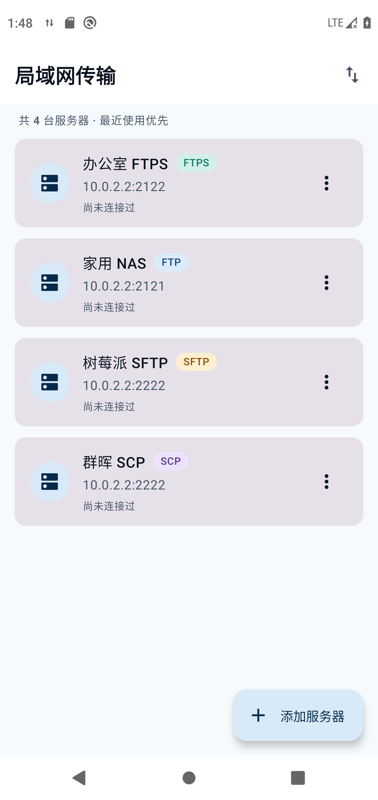
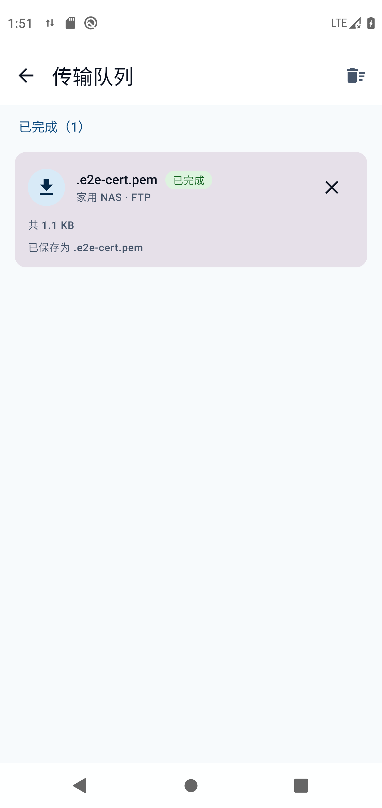

# 局域网传输 LanTransfer

一个 **Android 局域网文件传输** 应用：用手机连接同一局域网内的服务器，通过 **FTP / FTPS / SFTP / SCP** 四种协议浏览远端目录，并上传、下载文件。

> 架构选型与设计取舍见 [docs/ARCHITECTURE.md](docs/ARCHITECTURE.md)（ADR-001）。

| 服务器列表 | 远程浏览 | 传输队列 | 新增服务器 |
| --- | --- | --- | --- |
|  |  |  |  |

截图由仪器测试 [ScreenshotTourTest.kt](app/src/androidTest/java/com/manst/lantransfer/e2e/ScreenshotTourTest.kt) 在模拟器上用真实服务端数据生成。

## 功能

- **服务器管理**：新增 / 编辑 / 删除服务器配置，协议彩色标识，最近使用排序，一键「测试连接」。
- **远程浏览**：目录面包屑与上级导航、目录优先排序、文件大小/修改时间、刷新、错误重试。
- **文件操作**：下载到公共「下载/LanTransfer」目录（无需存储权限）、通过系统文件选择器多选上传、新建文件夹、重命名、删除（二次确认）。
- **传输队列**：串行执行、实时进度与速度、取消、重试、移除、清空已完成；有任务时以 `dataSync` 前台服务保活并显示进度通知。
- **四协议统一体验**：同一套浏览 / 传输界面，协议差异被适配层屏蔽。

## 协议支持

| 协议 | 实现库 | 默认端口 | 认证 | 说明 |
| --- | --- | --- | --- | --- |
| FTP | Apache Commons Net 3.11.1 | 21 | 用户名/密码 | 被动模式默认，可切换主动模式；MLSD 优先、LIST 回退 |
| FTPS | Apache Commons Net 3.11.1 | 21（隐式 990） | 用户名/密码 | 显式 `AUTH TLS`（默认）/ 隐式 TLS；可信任局域网自签名证书 |
| SFTP | JSch 0.2.26（mwiede 维护版） | 22 | 用户名/密码 | 基于 SSH2 子系统，流式传输 + 进度回调 |
| SCP | JSch 0.2.26（mwiede 维护版） | 22 | 用户名/密码 | 手写 SCP 线协议（`scp -f / -t`），元数据操作走远端 POSIX shell |

## 架构一览

```
Compose UI ──StateFlow──> ViewModel ──> ServerRepository / TransferManager
                                              │
                                              └──> RemoteFileSystem 抽象
                                                     ├── FtpRemoteFileSystem（FTP/FTPS）
                                                     └── SshRemoteFileSystem（SFTP/SCP）
```

- 单 Activity + Compose Navigation，MVVM + 单向数据流，手动依赖注入（`AppContainer`）。
- 协议适配层是**纯 JVM 代码**（不依赖 Android API），可直接用 JVM 单元测试对接内嵌 FTP/SSH 服务器做真实报文测试。
- 每任务独立连接、任务结束即关闭；取消传输 = 关闭连接。

## 构建

前置：JDK 21、Android SDK（platform 35、build-tools）、Gradle 由 wrapper 提供。

```powershell
# 统一入口（固定 JDK 21，Windows）
cmd /c "scripts\gw.cmd" :app:assembleDebug
cmd /c "scripts\gw.cmd" :app:assembleRelease

# 产物
#   app/build/outputs/apk/debug/app-debug.apk
#   app/build/outputs/apk/release/app-release.apk（R8 + 资源压缩，已用 lantransfer-release.jks 签名）
```

Release 签名配置位于 `keystore.properties`（含密钥库路径与口令，已在 `.gitignore` 中排除，请勿提交）。

安装：

```powershell
adb install -r app\build\outputs\apk\release\app-release.apk
```

## 测试与验证结果

### 1. JVM 单元测试（无需设备）

```powershell
cmd /c "scripts\gw.cmd" :app:testDebugUnitTest --console=plain
```

**结果：90 个用例全部通过（0 失败）。** 覆盖：

- `core`：远端路径归一化 / 拼接 / 父目录，字节与速度格式化；
- `data`：服务器配置 JSON 持久化（往返、损坏降级、并发写、删除/更新）；
- `transfer`：队列状态机、文件名清洗与重名后缀、速度与进度节流、错误映射；
- `protocol`：用 **MockFtpServer** 与 **Apache MINA SSHD** 在测试内启动真实 FTP/FTPS/SFTP/SCP 服务端，校验列目录、上传下载字节一致性（含 0 字节与 1 MiB 文件）、mkdir/rename/delete、错误密码与未监听端口。

### 2. 设备集成测试（真实四协议端到端）

宿主机启动四种协议的测试服务端（Python 3，依赖 `pyftpdlib`、`pyopenssl`、`paramiko`、`cryptography`）：

```powershell
python -m pip install pyftpdlib pyopenssl paramiko cryptography
python scripts\e2e_servers.py --masquerade 10.0.2.2
# 输出：FTP :2121  FTPS :2122  SFTP/SCP :2222  用户 test / test
```

启动模拟器后运行：

```powershell
cmd /c "scripts\gw.cmd" :app:connectedDebugAndroidTest -Pandroid.testInstrumentationRunnerArguments.class=com.manst.lantransfer.e2e.FourProtocolE2ETest --console=plain
```

**结果：在 Android 10（API 29）模拟器上 4 个用例全部通过**。该测试在 Android 运行时下逐协议真实执行：连接 → 列目录 → 下载 hello.txt → 上传 64KB → 回读字节比对 → 删除，并额外验证错误密码映射 `AuthenticationException`、未监听端口映射 `ConnectionException`、以及传输队列下载落盘 MediaStore。

> 模拟器网络说明：本机 QEMU 模拟器在高速大流量下可能静默丢字节（用设备端 `nc` 复现，非应用问题）。因此 `scripts/e2e_servers.py` 对 FTP/FTPS 数据通道做了限速；脚本内有注释说明，真机不受影响。

### 3. UI 冒烟测试

```powershell
cmd /c "scripts\gw.cmd" :app:connectedDebugAndroidTest -Pandroid.testInstrumentationRunnerArguments.class=com.manst.lantransfer.ui.AppSmokeTest --console=plain
```

**结果：2 个用例通过**（首屏标题 + 空状态；新增服务器跳转编辑页）。截图巡游测试 `ScreenshotTourTest` 也已通过并生成上方截图。

### 4. Release（R8 混淆）运行时验证

- `:app:assembleRelease` 产物用 `apksigner` 校验签名通过（CN=LanTransfer）；
- `mapping.txt` 确认 JSch / Commons Net 反射类被完整保留（ProGuard keep 规则生效）；
- 在 API 29 模拟器安装**签名 release APK**，真实添加 SFTP 服务器并浏览远程目录、下载文件到 `Download/LanTransfer/`，下载文件 MD5 与宿主端源文件一致（`e795467a…`）。证明 R8 混淆后 JSch 反射与传输链路正常。

## 使用

1. 手机与服务器连同一局域网 Wi-Fi；
2. 首页右下角「+」新增服务器：选择协议、填主机/端口/用户名/密码（FTPS 按需选择显式或隐式、信任自签名证书）；
3. 点「测试连接」确认可达后保存；
4. 点击服务器进入远端浏览：点目录进入、点文件下载；右上角上传按钮从系统文件选择器选文件；长按条目可重命名 / 删除；工具栏可新建文件夹；
5. 顶栏队列图标查看进度，支持取消与重试。

## 目录结构

```
app/src/main/java/com/manst/lantransfer/
├── core/        模型、异常、远端路径与格式化工具
├── protocol/    RemoteFileSystem 抽象 + FTP/FTPS/SFTP/SCP 适配器
├── data/        服务器配置仓库（JSON 持久化）
├── transfer/    传输队列、MediaStore 下载、通知与前台服务
├── ui/          Compose 界面（列表 / 编辑 / 浏览 / 队列）与 ViewModel
├── AppContainer.kt / LanTransferApplication.kt / MainActivity.kt
app/src/test/          JVM 单元测试（含内嵌 FTP/SSH 服务器）
app/src/androidTest/   设备集成测试（四协议端到端 / 截图巡游 / UI 冒烟）
docs/ARCHITECTURE.md   架构决策记录
docs/screenshots/      应用截图
scripts/               构建入口 gw.cmd / gw.ps1、端到端测试服务器 e2e_servers.py、自检 e2e_selftest.py
```

## 已知限制

- 不支持断点续传与文件夹递归上传/下载（单文件传输 + 失败重试）；SCP 协议本身不提供 REST 续传；
- SFTP/SCP 未做主机密钥指纹固定校验（首次连接直接信任）；FTPS 默认允许信任自签名证书，可在配置中关闭；
- 服务器密码以明文保存在应用私有目录（`filesDir/servers.json`，其他应用无法读取），未做加密存储；
- 应用进程被系统杀死后，内存中的传输队列不恢复；
- SCP 的列目录/建目录/重命名/删除依赖远端 POSIX shell（仅支持 SCP 传输、无 shell 的服务器只能下载/上传文件）；
- 未实现局域网服务发现（需手动填写地址）与「手机作为服务端」模式。

## 安全说明

- 所有流量仅在局域网内传输，应用不收集、不上传任何数据；
- FTPS/SFTP/SCP 走标准 TLS/SSH 加密；FTP 为明文协议，仅在可信局域网使用；
- `keystore.properties` 与签名密钥不入库。
